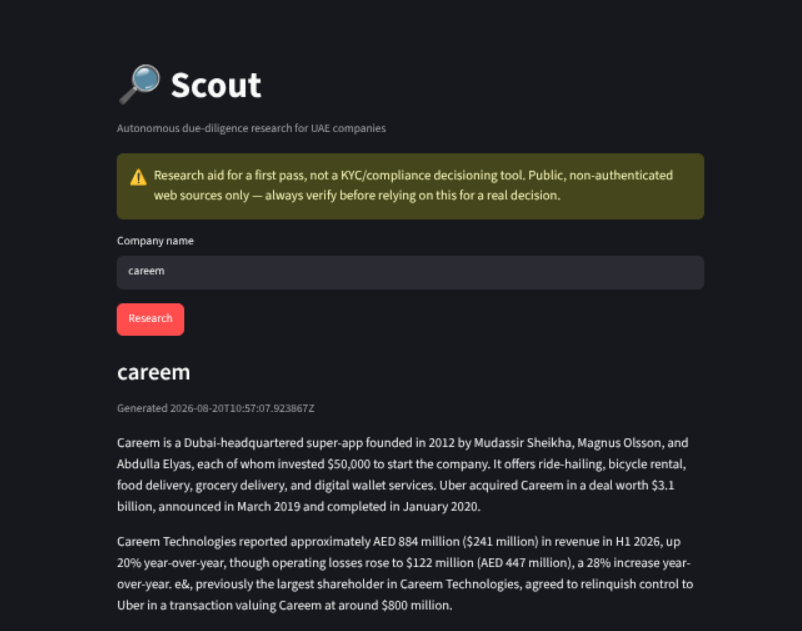
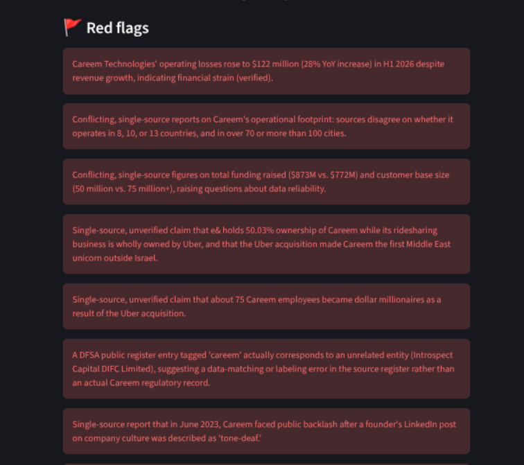
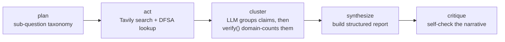
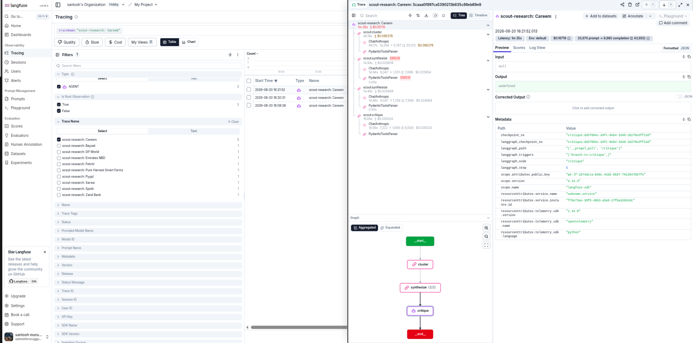

# Scout

Autonomous due-diligence research agent for UAE companies. Give it a
company name, get back a structured brief: what's verified, what's
flagged, and where every claim came from.

**Live demo:** https://scout-ui-nqv9.onrender.com
(bring your own [Claude API key](https://console.anthropic.com/settings/keys),
pasted into the sidebar. No key? [Run it locally with Ollama](#running-it-locally).
Cold starts on Render's free tier: the first request can take ~30s before
the actual 1-3 minute research run even begins.)

> Research aid for a first pass, not a KYC/compliance decisioning tool.
> Public, non-authenticated web sources only.

<p align="center">
  
  
</p>

## Why

First-pass company research — KYC screening, vendor checks, competitive
or investment diligence — is slow manual work: search, cross-check,
summarize, cite. Most "AI research agent" demos skip the hard part and
just present everything a model finds with the same confident tone.
Scout's whole premise is the opposite: tell me what's actually
corroborated, and *say so explicitly* when it isn't, instead of guessing.

There's no unified UAE company registry to query — mainland companies sit
with each emirate's Department of Economic Development, free-zone
companies with their own free-zone authority, and neither publishes a
public API. That's not a footnote here; it's the actual engineering
problem Scout is built around. See [Sources](#sources) below for how.

## Architecture



Five `StateGraph` nodes (`plan`, `act`, `cluster`, `synthesize`,
`critique` — the exact names in `graph.py`'s `build_graph()`), not a
single prompt or a prompt chain. Every transition is an explicit,
inspectable state update, which matters when the output is a report
someone might actually rely on.

Verification isn't its own graph node — it's a plain function call at
the end of `cluster_node`, right after the LLM groups raw findings into
claims. That's a deliberate choice, not an oversight: **the part that
does the real work is `verify.py`, and it's deliberately boring**,
plain deterministic Python with nothing for a graph node's retry/
observability machinery to add:

```python
def verify(clusters: list[ClaimCluster]) -> tuple[list[ClaimCluster], list[ClaimCluster]]:
    verified, flagged = [], []
    for cluster in clusters:
        distinct_domains = {domain_of(str(url)) for url in cluster.source_urls}
        (verified if len(distinct_domains) >= 2 else flagged).append(cluster)
    return verified, flagged
```

No model call, no judgment — a claim is `verified` only if 2+
independent source domains back it, otherwise `flagged`. That's the one
piece of this pipeline an auditor could check by hand. The judgment call
(recognizing that "founded 2014" and "launched November 2014" are the
same underlying claim, worded differently) happens one step earlier, in
an LLM clustering pass — separated on purpose so the actual
verified-vs-flagged decision never depends on a model's mood.

`synthesize` then builds each report's `key_facts` directly from that
split (confidence is copied, never re-decided), and only asks the model
to write the free-text summary and pick out red flags. `critique` is a
second pass over just that narrative — checking it doesn't state a
flagged claim as if it were verified, or assert something the underlying
evidence doesn't actually support.

## Sources

- **DFSA public register** (`dfsa.ae`) — real structured data (legal
  status, reference number, licence dates, endorsements, regulatory
  actions), plain server-rendered HTML, nothing in robots.txt blocks it.
  Covers DFSA-regulated financial firms specifically, not every UAE
  company.
- **DIFC Registrar of Companies** (`difc.com/public-register`) — lists
  entities, but the actual fields load via a client-side call under
  `/api/`, which `difc.com`'s own robots.txt disallows crawling. Scout
  cites the page URL rather than scraping around that.
- **Tavily web + news search** — the primary engine, cross-verified
  across independent domains. Neither register above exposes a search
  API (both 403 a direct query) — discovery goes through a broad Tavily
  search first, and only the specific allowed page that turns up gets
  fetched directly.
- **National Economic Register** (`growth.gov.ae`) — the one genuinely
  unified index (1.4M+ companies across mainland + free zones), but
  built for manual lookup, not automated querying. Not integrated; worth
  a manual cross-check for anything Scout returns.

## Eval

15 UAE companies — 7 well-documented, 5 smaller-but-real, 3 chosen
specifically because public information about them is sparse or
sources disagree (`eval/companies.json`). Ground truth is a hand-drafted
research pass, not an authoritative dataset — the point of the eval isn't
"Scout matches a perfect answer key," it's whether Scout's own confidence
labels are honest.

| Metric | Value |
|---|---|
| Factual recall (ground-truth facts Scout found at all) | 78.8% |
| Tool-call success rate | 100% |
| Flagging precision, sparse/conflicting tier | 37.5% |
| Avg. end-to-end latency | 92.6s |
| Tavily credits per report | ~9 (5 basic web search + 1 advanced news search + 1 advanced DFSA/DIFC discovery) |
| LLM cost per report | ~$0.14-0.17 (claude-sonnet-5, 3 calls: cluster/synthesize/critique — from real Langfuse traces) |
| Tavily credits used (full build + 15-company eval) | ~520 / 1,000 monthly free tier |

Run it yourself: `python -m eval.test_accuracy` (or `--limit N` for a
quick subset). Full per-company breakdown, including every individual
claim judgement, is in `eval/results.json`.

**A note on "confidence agreement," which isn't in the table above on
purpose:** comparing Scout's verified/flagged labels against the draft
ground truth's labels directly is misleading. Most disagreement (21 of
26 cases) is Scout's live multi-search pipeline finding *more*
corroboration than a quick hand-research pass did — e.g. marking "Emirates
NBD is headquartered in Dubai" verified when the draft ground truth only
had one source for it. That's Scout being more thorough, not wrong. The
5 cases running the other direction are the more meaningful signal.

### A real limitation the eval surfaced

`verify()` counts distinct domains per claim-cluster *in isolation*. When
two **contradictory** values for the same fact are each independently
repeated across multiple sources — Spotii's acquisition price ($16.3M
per one set of sources, $20M per another), Pure Harvest's total funding
($287M vs. $452M) — each value clears the 2-domain bar on its own, so
Scout marks *both* "verified" instead of catching that they conflict.
The eval's hand-drafted ground truth deliberately flagged these as
unresolved; Scout didn't catch the contradiction. Fixing this needs
cross-cluster contradiction detection (recognizing two clusters assert
different values for the same underlying fact), not a one-line patch —
deliberately left as the most concrete "what I'd build next."

## Tracing

Every report run is one Langfuse trace, with `cluster` / `synthesize` /
`critique` as nested spans and the LangGraph execution graph alongside
it. This particular trace happens to show the retry behavior working for
real, not just in a test — `scout:synthesize` failed once (red, `ERROR`)
and the retry succeeded on the second attempt:



## Stack

| Layer | Choice | Why |
|---|---|---|
| Orchestration | LangGraph | Explicit, stateful, auditable state transitions |
| Web/news search | Tavily API | Built for LLM agents, generous free tier |
| Structured source | DFSA public register + DIFC Registrar (link-only) | Real, citable, high-trust |
| Validation | Pydantic | Typed structured output, not free text |
| Tracing | Langfuse Cloud | Per-run trace, nested LLM spans, cost/latency |
| Reasoning | Anthropic Claude (visitor's own key), or a local Ollama model | Cluster/synthesize/critique nodes |
| Backend | FastAPI | Thin, submit-then-poll API in front of the graph |
| UI | Streamlit | Polls the API, renders the structured report |
| Deploy | Render (2 services, one repo) | Needs a persistent backend, not just a UI host |

## Running it locally

```bash
git clone https://github.com/santoshmuruggu/scout.git && cd scout
pip install -r requirements.txt
cp .env.example .env   # fill in TAVILY_API_KEY, a model (below), optionally LANGFUSE_*
```

Pick a model in `.env`:

- **Claude** (what the eval numbers above were measured with): set
  `ANTHROPIC_API_KEY`.
- **Ollama, no Anthropic key**: install [Ollama](https://ollama.com/download),
  `ollama pull qwen2.5:14b`, and set `LLM_PROVIDER=ollama` (plus
  `OLLAMA_MODEL` to use a different model). Pick a model that handles
  structured JSON output well. Small local models cluster claims less
  reliably than Claude.

Langfuse is optional: without its keys, tracing just switches off.

```bash
uvicorn api:app --reload --port 8000        # backend
SCOUT_API_URL=http://localhost:8000 streamlit run app.py   # UI, separate terminal
```

Or hit the graph directly without the API/UI layer:

```bash
python graph.py "Beehive"
```

### Bring-your-own-key on the live demo

The deployed demo has no Anthropic key of its own. The UI asks for the
visitor's key and sends it with the research request. `api.py` checks it
with one free `models.list` call so a bad key fails in a second instead of
after the web searches, then hands it to the graph for that one run. It
isn't stored in the job table, logged, or put into graph state (the model
object travels through LangGraph's run config instead). Server-side, a key
is only ever read from a local `.env` file, so an `ANTHROPIC_API_KEY`
configured on the host is ignored.

## Repo structure

```
scout/
├── graph.py            # LangGraph state machine: plan -> act -> cluster -> synthesize -> critique
├── llm.py               # model choice: Claude with an explicit key, or local Ollama
├── schema.py            # Pydantic models — Finding, ClaimCluster, Fact, DueDiligenceReport
├── verify.py             # the deterministic verified/flagged decision
├── tools/
│   ├── search.py          # Tavily web + news search, with retry/backoff
│   └── difc.py             # DFSA register lookup + DIFC register citation
├── api.py                 # FastAPI: submit-then-poll research endpoint + /config
├── app.py                 # Streamlit UI
├── eval/
│   ├── companies.json      # 15-company eval set with hand-drafted ground truth
│   ├── test_accuracy.py     # eval harness (LLM-as-judge + deterministic tool/timing stats)
│   └── results.json          # full results from the latest eval run
├── render.yaml             # 2-service Blueprint (scout-api, scout-ui)
└── Procfile
```

## What breaks, and what happens when it does

- **A search or register lookup fails**: retried 3x with exponential
  backoff (`tools/__init__.py`); still failing, that sub-question's
  findings are just skipped rather than failing the whole report
  (`graph.py`'s `act_node`).
- **The model returns malformed structured output** (happened during the
  eval — a nested list arriving as a JSON-encoded string once, a
  truncated field another time): same retry treatment, reused from the
  tool-call layer.
- **The critique pass itself fails**: it's a refinement step over an
  already-complete report, not load-bearing — falls back to the
  pre-critique draft instead of losing the report.
- **Nothing is found at all**: an explicit "no public information could
  be found" report, not a fabricated one.
